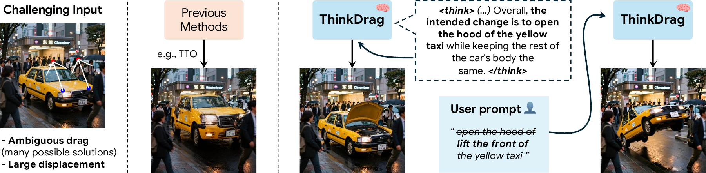
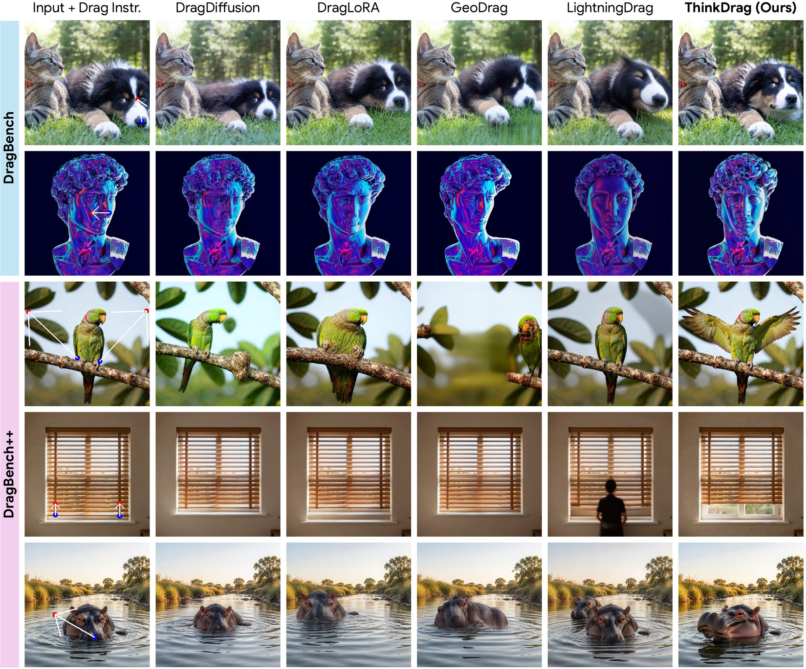
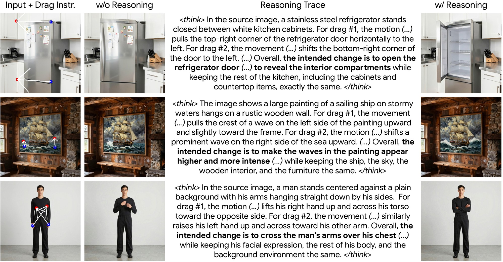
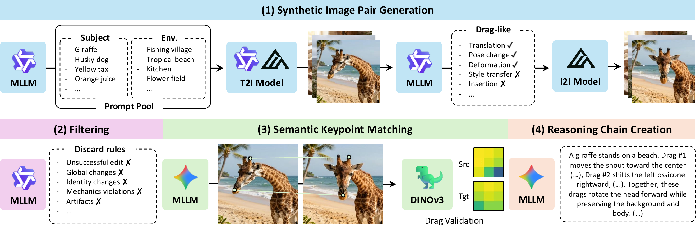
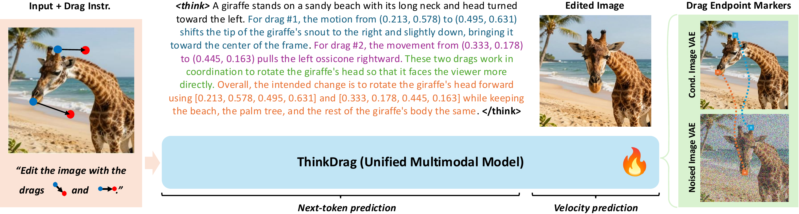

<div align="center">

<h1><i>ThinkDrag</i>: Semantic Drag-Based Image Editing with Visual Reasoning</h1>

**[Armando Fortes](https://atfortes.github.io/) &emsp; [Tianyi Wei](https://wtybest.github.io) &emsp; [Chindanai Trakantannarong](https://www.linkedin.com/in/chindanai-trakan/) &emsp; [Shangchen Zhou](https://shangchenzhou.com) &emsp; [Xingang Pan](https://xingangpan.github.io)**

**S-lab, Nanyang Technological University**

[](https://atfortes.github.io/projects/thinkdrag/)
[](https://arxiv.org/abs/2610.13316)

---

**ThinkDrag interprets sparse drag handles as semantic edits**

It can reason about the intended transformation before generating.



</div>

## 📖 Overview

**ThinkDrag** is a **drag-based image editing** method built on a **unified multimodal model**. Rather than treating drags as geometric displacements, it interprets them as **semantic transformations** and can optionally produce a **visual reasoning trace** before generating the edit. To support this, we construct a **training dataset of semantic drag transformations paired with reasoning traces**, and introduce **DragBench++**, a benchmark of challenging drag-based editing scenarios with reference edits.

## 📮 Update
- [2026.10] This repo is created.

## 🚧 TODO
- [ ] Release DragBench++
- [ ] Release Dataset
- [ ] Release Model Weights
- [ ] Release Inference Code

## 🖼️ Results

**Semantic transformations.** Same input and drag handles across drag-based image editing methods.



**Reasoning-guided edits.** ThinkDrag can first infer the intended edit from the handles, then use that reasoning trace to guide generation.



## 🧩 Method

**Dataset.** Synthetic image pairs are filtered, matched with semantic keypoints, and paired with reasoning chains.



**Model.** Drags are represented as structured text tokens and Drag Endpoint Markers in a unified multimodal model.



## 📑 Citation

If you find our work useful, please consider giving this repo a ⭐ to support our work and citing the following paper:

```bibtex
@article{fortes2026thinkdrag,
  title   = {ThinkDrag: Semantic Drag-Based Image Editing with Visual Reasoning},
  author  = {Fortes, Armando and Wei, Tianyi and Trakantannarong, Chindanai and Zhou, Shangchen and Pan, Xingang},
  journal = {arXiv preprint arXiv:2610.13316},
  year    = {2026}
}
```

## ©️ License

This project is licensed under [NTU S-Lab License 1.0](./LICENSE). Redistribution and use should follow this license.

## 🤝 Acknowledgements

We would like to thank the drag-based editing community and the many works that paved the way for this one since [Drag Your GAN](https://github.com/XingangPan/DragGAN). In particular, we compare against [DragDiffusion](https://github.com/Yujun-Shi/DragDiffusion), [DragNoise](https://github.com/haofengl/DragNoise), [DragLoRA](https://github.com/Sylvie-X/DragLoRA), [FastDrag](https://github.com/XuanjiaZ/FastDrag), [GeoDrag](https://github.com/xinyu-pu/GeoDrag), [InstantDrag](https://github.com/SNU-VGILab/InstantDrag) & [LightningDrag](https://github.com/magic-research/LightningDrag).

We also thank the following projects that made this work possible:

- [BAGEL](https://github.com/ByteDance-Seed/Bagel) is the base unified multimodal model that ThinkDrag is built upon.
- [Qwen3-VL](https://github.com/QwenLM/Qwen3-VL) is used to write source-image and edit prompts for the dataset.
- [Qwen-Image](https://github.com/QwenLM/Qwen-Image), [FLUX.2](https://github.com/black-forest-labs/flux2) & [Z-Image](https://github.com/Tongyi-MAI/Z-Image) are used to synthesize the dataset image pairs.
- [Gemini 3](https://deepmind.google/models/gemini/) is used to estimate semantic keypoints and write reasoning traces.
